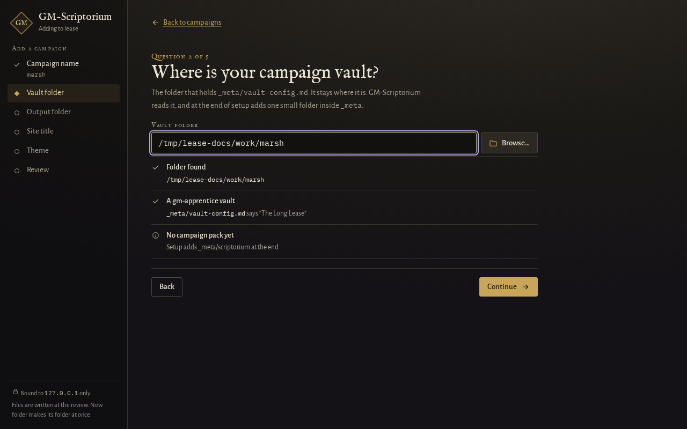
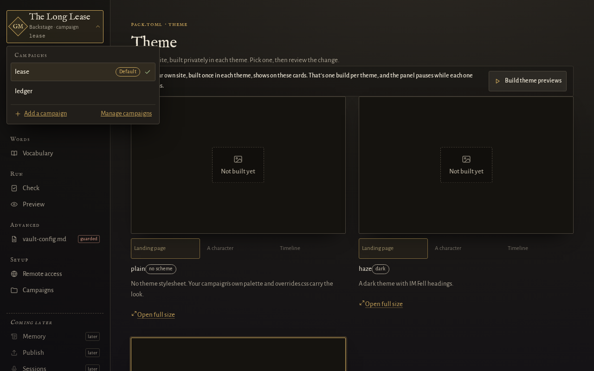
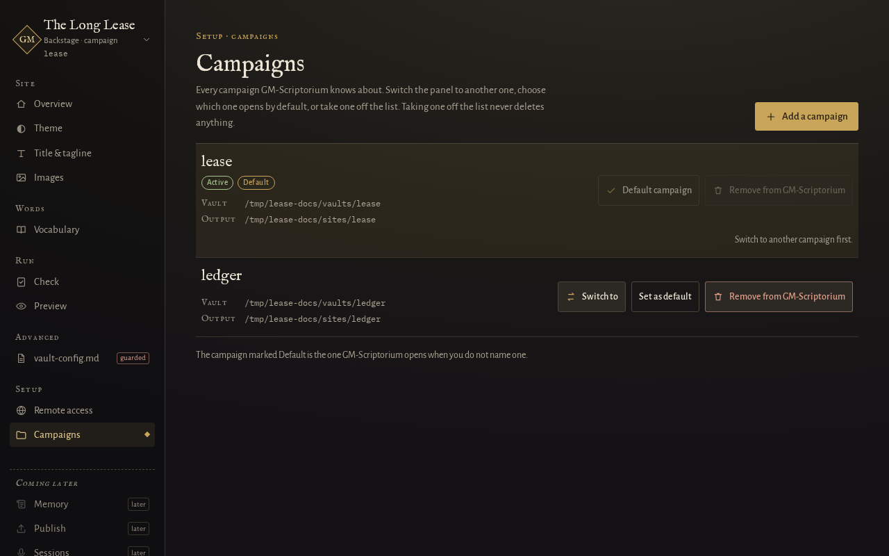

# Add another campaign, and switch between them

This guide is for a GM who already has one campaign set up and wants to add a second, move the
admin panel between campaigns, or tidy the list. Setting up the first one is in
[start a new campaign](start-a-new-campaign.md).

GM-Scriptorium keeps a list of your campaigns in its settings file. Each entry has a name, a vault
folder and an output folder. One campaign is the **default**: the one the tool uses when you do not
name one.

## In the admin panel

*Since 0.5.0.*

### Add a campaign

1. [Open the admin panel](../using.md#quick-start).
2. Press **Add a campaign**. It is on the Campaigns screen, under Setup, and at the bottom of the
   campaign list at the top of the panel.



3. Say whether you already have a vault or want a new one, then answer the questions. They are the
   same as in [start a new campaign](start-a-new-campaign.md), with the same checks. The panel also refuses a
   name, vault or output folder that clashes with a campaign you already have. A build replaces
   everything in its output folder, so the panel will not let one campaign's output folder sit inside
   another campaign's vault.
4. Press the button named **Add** and your campaign's name on the last screen. Nothing is written
   before it.
5. Choose whether to switch. You can switch and build its first preview, switch without building,
   or stay where you are. Your default campaign does not change unless you had none.

The panel stays on its current campaign while you add, so you can add one without losing your place.
Adding works from a remote browser too. There, a path you type is checked when you leave the box, and
the panel's audit log records the addition.

### Switch between campaigns

Press the campaign name at the top of the panel. The list opens, and choosing another campaign
switches the whole panel to it, from this computer or from a remote browser. If you have unsaved
changes on the page, the panel asks before it switches. A browser tab left open on the old campaign shows a banner and asks you to reload before
it lets you change anything.



A panel that was started with the `--vault` flag cannot switch. The panel tells you why. Restart it
without `--vault` to switch.

### Choose the default, or take one off the list

Open **Campaigns** under Setup. Each campaign shows its vault and output folders.



- **Set as default** makes that campaign the one that opens when you do not name one.
- **Remove from GM-Scriptorium** takes it off the list. That is all it does: the vault, the pack, the
  built site and the backups all stay where they are. You can add the campaign again later. The
  campaign the panel is on cannot be removed, so switch to another one first.

## On the command line

Every command takes a campaign name, such as `gm-scriptorium build lease`. Leave the name out and the
command uses your default. Each line below changes only the list, never a vault.

```
gm-scriptorium config list
```

Lists each campaign with its vault and output folders, and marks the default.

```
gm-scriptorium config add archive --vault ~/campaigns/archive --out ~/sites/archive
```

Adds a campaign. It needs both `--vault` and `--out`. A name you already use is replaced, so check
`config list` first. To create a brand new vault as well, use
`gm-scriptorium init --new-vault <folder> --system none --name archive` instead.

```
gm-scriptorium config set-default archive
```

Makes `archive` the default.

```
gm-scriptorium config remove archive
```

Takes `archive` off the list. It says "Nothing on disk was touched or deleted", and means it.

Switching has no command of its own. You switch by naming the campaign: `gm-scriptorium serve archive --admin`
opens the panel on it. The flags and exit codes are on
[the command line reference](../reference/command-line.md), and the settings file is described in
[the settings file](../reference/config-toml.md).

## Next

- [Change how your site looks and the words it uses](change-the-look-and-vocabulary.md)
- [Keep a copy of the settings file](../backing-up-your-vault.md)
