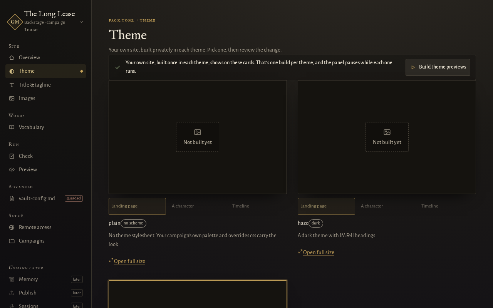
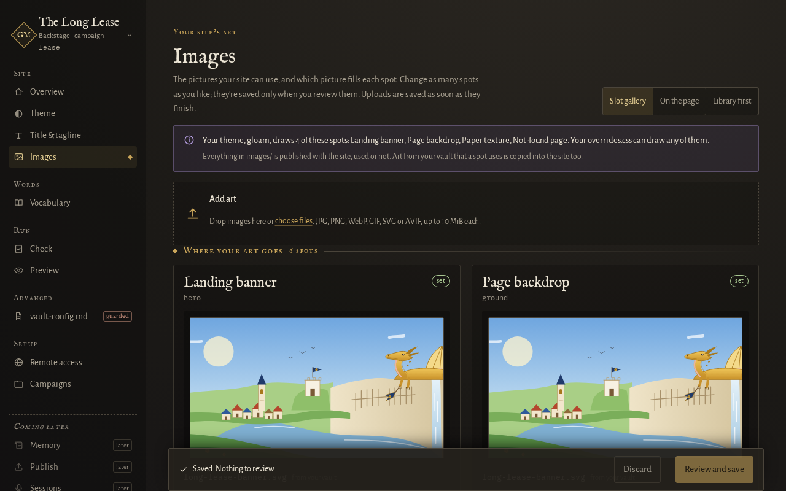
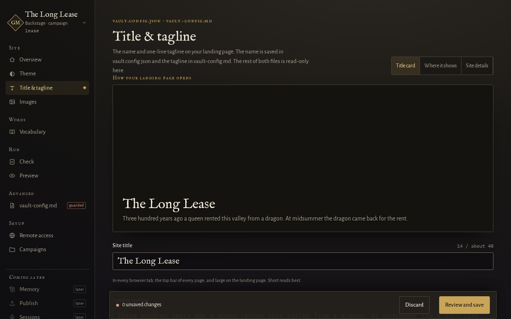
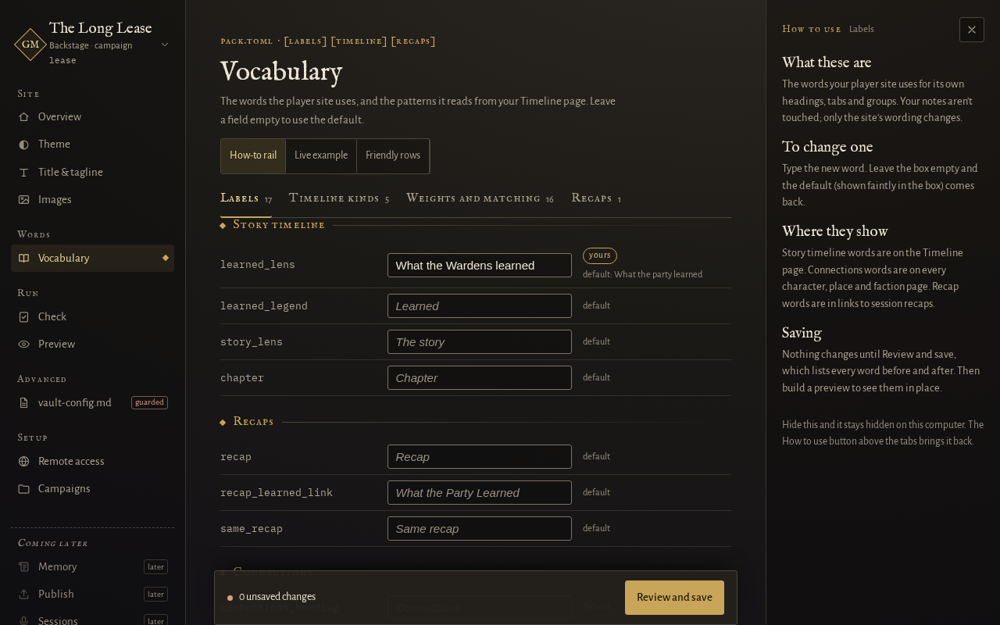

# Change how your site looks and the words it uses

This guide is for a GM who has a campaign set up and wants to change the theme, the pictures, the
site's title and tagline, or the words the player site uses, such as the name of the party. If you
have no campaign yet, start with [start a new campaign](start-a-new-campaign.md).

A **theme** is the look of the whole site: colours, fonts and layout. A **slot** is a named place
where your own picture can go. Your choices live in a small file called `pack.toml`, in your vault's
`_meta/scriptorium/` folder. Nothing you change here touches your notes.

## In the admin panel

Each screen below is in the panel's left-hand list. Every change is shown to you in a review step and
saved only when you confirm.

1. [Open the admin panel](../using.md#quick-start). *Since 0.5.0.* If you have more than one campaign,
   switch to the one you want (see [add another campaign](add-another-campaign.md)).

### Theme

2. Open **Theme** and press **Build theme previews**. The panel builds your own site privately in each
   theme: `gloam`, `haze` and `plain`. `gloam` is a dark theme that ships its own fonts, and it is
   what a new campaign gets. Pick one and press **Review change**. The panel shows the line in
   `pack.toml` that will change. Read it, then press the save button to keep it.



### Images

3. Open **Images**. Each slot is one place a picture can go: a landing banner, a page backdrop, a
   paper texture, an emblem frame, a character portrait and a not-found page. Press **Choose art** on a
   slot to pick a picture from your vault's attachments folder, or upload one. Change as many slots as you like, then
   press **Review and save** and confirm. Uploads are saved as soon as they finish.

   A slot shows only where the theme or your own `overrides.css` draws it. [Image slots](../image-slots.md)
   says which do, and the sizes to prepare each picture at.



### Title and tagline

4. Open **Title & tagline**. The title is the name in the top bar and the page title. The tagline is
   the one line under it on the landing page. Press **Review and save**, read what will change, then confirm the save.

   The title is saved in `vault.config.json`, and the tagline in your vault's `_meta/vault-config.md`.
   The panel keeps a copy of `_meta/vault-config.md` outside the vault before every save. Where each
   key lives is on [the vault's publish settings](../reference/vault-config.md).

   If gm-apprentice has moved your vault's settings to `_meta/vault-config.yaml`, the title and
   tagline come from that file, and the screen shows them without letting you change them. Change
   them in that file for now; editing them in the panel arrives in the next update. If your
   campaign pack still holds settings the site no longer reads, such as the old title or hide
   lists, the screen lists them. Press **Carry these settings** to move them into
   `_meta/vault-config.yaml`. The panel keeps a copy of both files outside the vault first, then
   shows what moved. The `carry` command does the same from the command line.



### Vocabulary

5. Open **Vocabulary**. This is where you rename the words the player site uses, for example the
   heading for the party, and the patterns the timeline looks for on your Timeline page. Leave a
   field empty to use the built-in word. Press **Review and save**, read what will change, then confirm the save.

   Every word you can change is listed on [the campaign pack file](../reference/pack-toml.md).



### Check, then look

6. Open **Check** to run the same checks as `gm-scriptorium check`, then **Preview** to build the
   site privately on this computer. Nothing is published. After a save, the panel also offers to
   build a preview.

## Editing pack.toml by hand

You can change the same things in a text editor. The file is `_meta/scriptorium/pack.toml` in your
vault. Every key, with its allowed values, is on
[the campaign pack file](../reference/pack-toml.md).

**Take care: a save from the panel rewrites the whole file and loses any comments you added.** The
panel warns you before it does. If you keep notes in `pack.toml`, edit it by hand and do not use the
panel for the screens above. A mistyped key is ignored with a warning, so run the check afterwards.

```
gm-scriptorium check lease
```

```
gm-scriptorium build lease
```

`check` reads the pack file and prints a `warning:` line for a key it does not know, and stops with
an error for a theme it does not know. `build` makes the site with your change. To look at it, run
`gm-scriptorium serve lease`. The flags are on [the command line reference](../reference/command-line.md).

## Next

- [Add another campaign, and switch between them](add-another-campaign.md)
- [How GM-Scriptorium decides what players see](../explanation/what-players-see.md)
