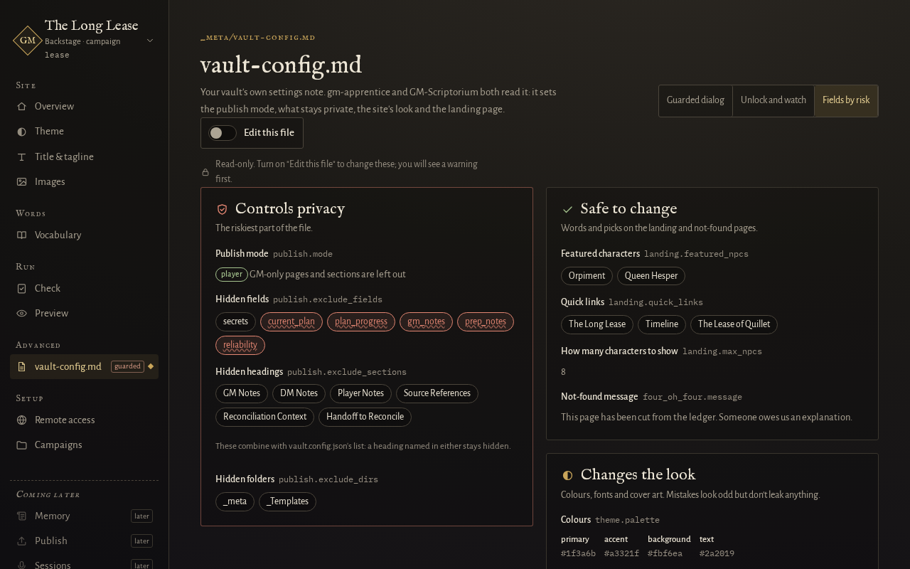
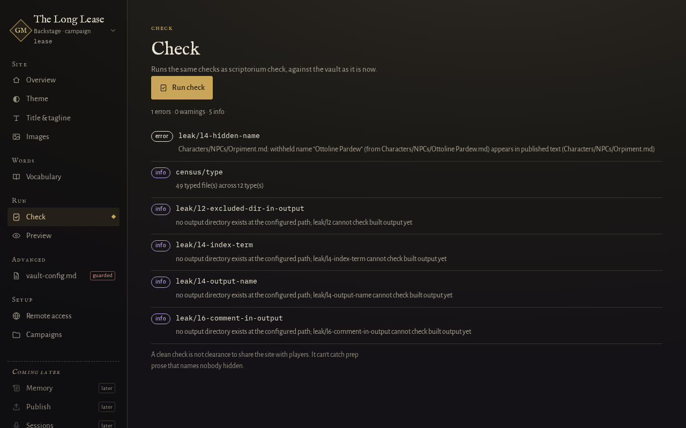

# Keep GM-only notes off the player site

This guide is for a GM who has secrets in their campaign vault and wants to be sure players never see them on the built site. It lists the ways to hide something, from a whole page down to one name, and ends with how to check your work.

The rules behind each method, and what the checks cannot see, are in [How GM-Scriptorium decides what players see](../explanation/what-players-see.md). The examples use the sample campaign, [The Long Lease](../../examples/README.md). Try them on a copy, never on the original.

**A clean check is not clearance.** The checks look for known names and headings. They cannot tell that a paragraph gives away a secret. Read the built site yourself before you share it (last section).

## Hide a whole page

Players see a page only if the publish manifest lists it. The manifest is `_meta/publish-manifest.md`, and in the default player mode it is an allowlist. A page is on the site if it is ticked under `## Publishing`. A page under `## Needs Decision` or `## Excluded`, or one that is not in the manifest at all, stays off.

1. Open `_meta/publish-manifest.md`.
2. Delete the page's line from `## Publishing`, or move it under `## Excluded`. For example, `- [x] Creatures/Shedling.md` is the line for the Shedling page.
3. Run `gm-scriptorium check lease` and then `gm-scriptorium build lease`. The page is not built, and links to it show as plain text. `check` warns about each of those links (`leak/l3-unpublished-link`), so you can decide whether the page that names it should say so.

Another way is to put `publish: false` in the page's own frontmatter (the block between two `---` lines at the top). A page with `publish: false` stays off even if the manifest ticks it.

## Hide part of a page

Three things are cut from a page that does publish. All three work in any published page.

- **A section under a hidden heading.** In the sample, a `## GM Notes` heading and everything under it are removed. The headings that are hidden are the vault's `exclude_sections` list, so check it first (see "Check what is hidden" below). It is set in `_meta/vault-config.md`, and the built-in list applies only if the vault sets none.
- **A block between two comments.** Put `<!-- gm-only -->` on a line by itself, the secret text, and `<!-- /gm-only -->` on a line by itself. Everything between them is removed. The sample's Tally Cliffs page does this for the cave under the ledge.
- **An Obsidian comment.** Text between `%%` and `%%` is removed before the build. `check` says how many it withheld (`leak/l6-comment-withheld`, an information line). If you forget the closing `%%`, everything to the end of the file is hidden and `check` warns (`leak/l6-comment-unterminated`).

Anything outside those three stays on the page.

## Hide a field in a page's frontmatter

A page's frontmatter holds fields such as `occupation` or `secrets`. A field named in the hidden fields list is removed from every page.

1. [Open the admin panel](../using.md#quick-start).
2. Open the **vault-config.md** screen, then **Fields by risk**.
3. Turn on **Edit this file**, read the warning, tick **I understand. Unlock the fields.** and choose **Unlock**.
4. Under **Hidden fields**, choose **+ add**, type the field's name and press Enter.
5. Choose **Review and save**. The panel shows the change and the result of a check on an edited copy. Choose **Back up and save**. It keeps a copy of the file outside the vault first.

You can also add the name to `exclude_fields` under `publish:` in `_meta/vault-config.md` by hand. The campaign's `vault.config.json` can have its own list, and the two lists are joined. Both are in [the vault's publish settings](../reference/vault-config.md).

To hide a field on one page only, list it in that page's `publish_exclude_fields`.

## Hide a relationship

A relationship between two pages is an entry under `relationships:` in the page's frontmatter. Add `gm_only: true` to an entry and it is left out of the built site, while the page itself still publishes. The sample's Ottoline Pardew page uses this on every relationship. Write it exactly as `gm_only: true`: any other value, such as `yes`, `on` or `"True"`, leaves the relationship on the site, and `check` reports it.

## Keep a name from appearing anywhere

Some names must never reach a player, even by accident in another page's text. Mark the hidden character's own page with `withheld: true` in its frontmatter, and list it under `## Excluded` in the manifest. The leak checks then search every published page, the built site and its search index for that page's name.

1. Open the page and add `withheld: true` to its frontmatter.
2. Move its line in `_meta/publish-manifest.md` from `## Publishing` to `## Excluded`. A withheld page that is also published fails with `leak/l4-name-collision`, because the page and its name would both be public.
3. Run `gm-scriptorium check lease`.

If the name is already used in published pages, `check` stops with exit code 2 and lists every one (`leak/l4-hidden-name`, plus `leak/l3-unpublished-link` for each link to the page). Rewrite those lines, or move the secret under a hidden heading, and run `check` again.

To see it work on a new page, open `Characters/NPCs/Orpiment.md` in a copy of the sample and type `Ottoline Pardew was seen here.` on the line under the `# Orpiment` heading. `check` exits with code 2 and prints `leak/l4-hidden-name`. Put the same sentence under `## GM Notes` instead and it passes, because that section is cut.

Names shorter than three characters, and generic aliases such as "the Landlady", are not searched for. The full list is in the explanation page's "Withheld names" section.

## Check your work

1. Run `gm-scriptorium check lease`. Exit code 2 means a leak was found, and nothing was built. Every message it can print, and what to do about it, is in [check messages](../reference/check-messages.md).
2. Run `gm-scriptorium build lease`. The build checks again, this time against the finished site, and refuses to publish if it finds a leak.
3. Search the output for a phrase from each secret. The built site is plain files, so any search tool will do.
4. Open the site and read it as a player would. The checks cannot see [what is listed here](../explanation/what-players-see.md#what-the-leak-checks-cannot-see): prose that gives a secret away without a name, or GM framing under a heading nobody listed.

## Check what is hidden

The hidden headings and fields come from the vault's settings, not from this page. If a heading or field is not on the list, it is not hidden. Look at the lists in the panel (**Hidden fields** and **Hidden headings** on the vault-config.md screen) or in [the vault's publish settings](../reference/vault-config.md), which also gives the built-in lists.
