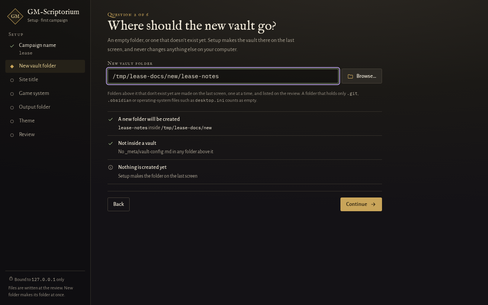
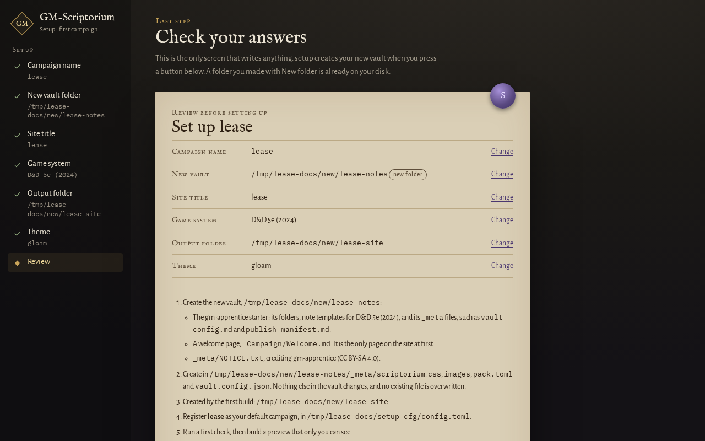

# Start a new campaign

This guide is for a GM who has just installed GM-Scriptorium and wants to set up their first
campaign. You might already have a vault, or you might have nothing yet and want the tool to make
one.

A **vault** is the folder of markdown notes you keep for one campaign. [What you need](../using.md#what-you-need)
says what it must hold. Setup only adds a small folder inside it, `_meta/scriptorium/`, and never
overwrites or removes anything.

## In the admin panel

*Since 0.5.0.*

1. [Open the admin panel](../using.md#quick-start). With no campaign registered yet, it starts with
   setup instead of your campaign.
2. Under "How do you want to start?", choose **I already have a vault** or **Start a new campaign**,
   then press **Start**. The first asks five questions. The second asks six, because it also makes
   the vault.



3. Answer the questions. Each answer is checked as you go, and the panel shows the reason when it
   refuses one.
   - **Name.** A short name for commands and folders: lowercase letters, digits and hyphens, such as
     `lease`. You type it in commands like `gm-scriptorium build lease`.
   - **Your vault folder**, or for a new campaign, **where the new vault should go**. A new vault goes
     in a folder that is empty or does not exist yet. Press **Browse** to pick a folder from a list,
     or type the path.
   - **Site title.** What players see at the top of every page. Spaces and capitals are fine here.
   - **Game system** (a new campaign only). `none`, or one of the systems the list offers. Setup adds
     note templates for it. They are ordinary notes you can change.
   - **Output folder.** Where the player site is built. It must be outside your vault, so the site
     never mixes with your notes. The panel suggests a folder next to your vault. On this question,
     **New folder** makes a folder straight away, and it stays even if you cancel.
   - **Theme.** A look for the site. You can change it later; see
     [change how your site looks](change-the-look-and-vocabulary.md).
4. Read the review screen. It lists what will be written. Nothing is written before it, apart from
   a folder you made with **New folder**.



5. Press **Build my first preview**, or **Set up without building**. Setup then writes the same pack
   files and registers the same campaign as `gm-scriptorium init --yes` does. With a preview, it builds
   the first one into the panel's own preview folder. Either way it opens the panel on your campaign
   without restarting.

Setup listens on this computer only, whatever your remote access settings say.

If the vault is on a network share, the review reminds you to commit it to git first. The panel never
runs git for you. A new vault inside a OneDrive folder is allowed, and the panel tells you to let
OneDrive finish syncing before you open the vault on another computer.

### Browse and New folder

The vault and output questions have a **Browse** button. It opens a list of folders under the field,
starting at the deepest folder that already exists above what you typed. The list shows folders only,
never files. A link or shortcut is marked and cannot be opened there, so type its path instead.
**Choose this folder** fills the field and runs the usual check. On the output question, **New folder**
makes a folder inside the open one straight away. Browse works from another device too, and the
panel's audit log records it.

## On the command line

Use this if you prefer a terminal, or you are writing a script. The examples use `lease` as the
campaign name.

**No vault yet.** *Since 0.5.0.* This makes one in a folder that does not exist or is empty:

```
gm-scriptorium init --new-vault ~/campaigns/lease --system none --name lease
```

`--system` is never guessed. Use `--system none`, or one of the ids the command lists when you give
it one it does not know: `dnd-5e-2024`, `fitd`, `pf2e` or `none`. If the folder is not empty, the
command refuses and creates nothing. Missing parent folders are created too, and listed first. If
the command stops part-way, it lists exactly what it made.

**You already have a vault:**

```
gm-scriptorium init --vault ~/campaigns/lease --name lease --out ~/sites/lease --yes
```

Plain `gm-scriptorium init` at a terminal asks whether you already have a vault, then asks the
questions that follow. With piped input it asks nothing, so scripts give the flags and `--yes`.

**To register a vault you have already set up**, without running `init`:

```
gm-scriptorium config add lease --vault ~/campaigns/lease --out ~/sites/lease
```

`config add` needs both `--vault` and `--out`. If the name is already used, it replaces that
campaign's entry. The panel refuses a name that is already used instead.

Then run `gm-scriptorium check lease` and `gm-scriptorium build lease`. Every flag is listed on
[the command line reference](../reference/command-line.md).

## What it writes

Setup writes only to `_meta/scriptorium/` inside the vault (a `pack.toml`, a `vault.config.json`
and two folders, `css/` and `images/`), your settings file, and the new vault when you ask for one.
It never overwrites a file. If a file is already there, it is left alone and the command says so.
The full list, with what is safe to delete, is on
[files and folders](../reference/files-and-folders.md). The keys in the two files are on
[the campaign pack file](../reference/pack-toml.md) and
[the vault's publish settings](../reference/vault-config.md).

## Next

- [Add another campaign, and switch between them](add-another-campaign.md)
- [Change how your site looks and the words it uses](change-the-look-and-vocabulary.md)
- [Back up your vault](../backing-up-your-vault.md)
