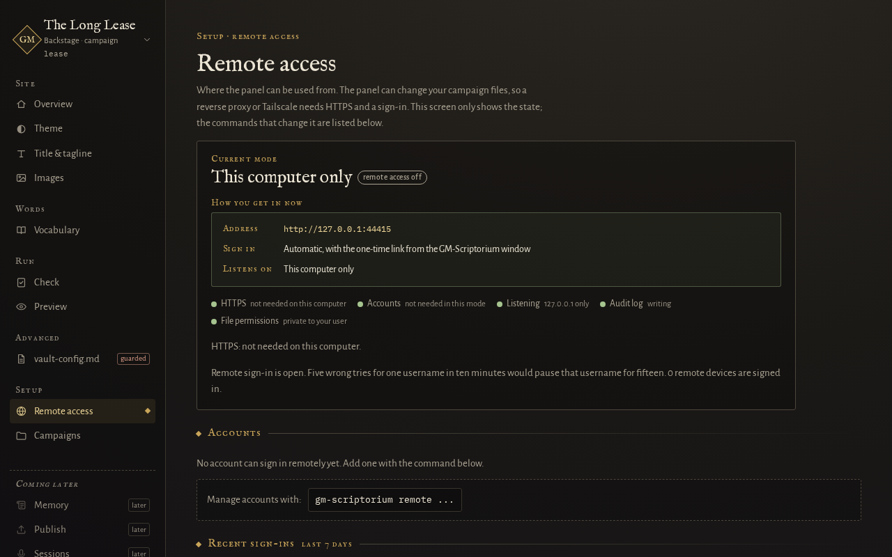

# Remote access to the admin panel

By default the GM admin panel (`gm-scriptorium serve --admin`) answers only on the computer it runs
on, and nothing here changes that. This page is for a GM who runs GM-Scriptorium on another machine
(a home server, a VM) and wants to use the panel from a laptop or phone. It is opt-in, it is set up
from the command line, and the reasoning behind it is in
[ADR 0029](decisions/0029-remote-access.md).

The names and addresses below are neutral examples: `scriptorium.home.arpa` for the panel,
`preview.scriptorium.home.arpa` for its preview, `192.0.2.42` for the machine running
GM-Scriptorium and `198.51.100.20` for a reverse proxy. Use your own.

## 1. What remote access is

Remote access is a saved setting, never a flag. There is no `--host` for `serve --admin`: the panel
reaches other devices only because you ran `gm-scriptorium remote set ...`, and `serve --admin` then checks the whole setting before it opens
a single socket. If anything is missing it stops with one line saying what, and it never falls back
to a wider address. *Since 0.5.0.* The `tailscale` and `proxy` modes also need an account, made with `gm-scriptorium remote account add <name>`. Versions before 0.5.0 have no accounts: they ask for one password, set with `gm-scriptorium remote password`.

A reverse proxy or `tailscale serve` needs HTTPS and a sign-in. *Since 0.5.0.* The sign-in takes a username and a password. An SSH tunnel needs neither,
because SSH has already authenticated and encrypted the connection (see section 8). Every mode also
gets the panel's own checks on who is asking: the Host and Origin of every request, and which
machine the request came through. The panel can change your campaign files, so those checks are
not optional.

## 2. The modes

| Mode | Where it listens | Who can connect | HTTPS comes from | Sign-in |
|---|---|---|---|---|
| `local` (the default) | `127.0.0.1`, any free port | this computer | not needed | the one-time link |
| `ssh` | `127.0.0.1`, two fixed ports | this computer, including an SSH tunnel to it | the tunnel | the one-time link |
| `tailscale` | `127.0.0.1`, two fixed ports | `tailscale serve` on this computer | `tailscale serve` | *Since 0.5.0.* a username and password |
| `proxy` | an address you choose, plus `127.0.0.1`, two fixed ports | your reverse proxy and this computer (over 127.0.0.1 only, not its network address); every other machine is dropped before any HTTP | your proxy | *Since 0.5.0.* a username and password |



In `tailscale` and `proxy` mode the panel always also answers on `127.0.0.1`, so the one-time link
printed when it starts keeps working on the machine itself. That is your way back in if you lose
every password.

Remote settings are per machine, and so are the fixed ports: there is one set of them, and one
remote panel at a time.

## 3. Setting it up from the command line

Everything is `gm-scriptorium remote ...`, and it all works over SSH on a machine with no screen.
Add `--config <path>` to each command if you start GM-Scriptorium with a config of your own.

```
gm-scriptorium remote set --mode proxy --admin-url https://scriptorium.home.arpa --preview-url https://preview.scriptorium.home.arpa --bind 192.0.2.42 --trusted-proxy 198.51.100.20 --port 7400 --preview-port 7401
```

```
gm-scriptorium remote account add rook
```

*Since 0.5.0.* `remote account add` makes the account you sign in with. Versions before 0.5.0 have no accounts: they ask for one password, set with `gm-scriptorium remote password`.

```
gm-scriptorium remote show
```

`set` checks every value as you give it (an address that is not `https://` is refused with "remote
access needs HTTPS", a port outside 1 to 65535 is refused, and so on) and writes nothing if any of
them is wrong. `show` lists what applies to the current mode and whether it is ready to start, and
never prints a secret. Changes take effect the next time `serve --admin` starts. Changing `--mode` drops the old admin and preview addresses (a proxy's names mean nothing to a tailnet) unless the same command gives new ones; the other settings are kept. Each subcommand has its own help: `gm-scriptorium remote set --help`.

*Since 0.5.0.* `account add` asks for the new password with nothing echoed, and again to confirm. It is read only
from the terminal or, when there is no terminal, from standard input, one line each, for example
`printf '%s\n' "your new passphrase" | gm-scriptorium remote account add rook`. It is never accepted
as an argument or from an environment variable, because both are visible to other programs. The
password must be at least 12 characters; there are no other rules.

Then start the panel as usual with `gm-scriptorium serve my-campaign --admin`. In a remote mode it
first prints a `WARNING:` line saying who can reach it, then the addresses, then the one-time link
for use on that machine.

The account rules and the other `remote` commands (signing devices out, turning remote access off) are on the
[reference page](reference/remote-access.md#accounts). The common ones are under Everyday tasks at the end of this page.

## 4. Behind Caddy

Run Caddy anywhere that can reach the panel, with one site block per name. The panel's `proxy`
mode needs two names: one for the panel and one for the preview.

```
scriptorium.home.arpa {
	reverse_proxy 192.0.2.42:7400
}

preview.scriptorium.home.arpa {
	reverse_proxy 192.0.2.42:7401
}
```

Caddy keeps the browser's `Host` header as it is when it talks to a plain HTTP upstream, sets
`X-Forwarded-Proto` and `X-Forwarded-For`, and gets its own HTTPS certificates. **Do not add
`header_up Host ...`**: the panel checks the exact name the browser asked for and refuses anything
else. This block was checked with `caddy adapt` (Caddy v2.11.4) and not run against anyone's real
proxy; running it is on you.

Tell GM-Scriptorium which machine the proxy is, so that every other machine is dropped:

```
gm-scriptorium remote set --mode proxy --bind 192.0.2.42 --trusted-proxy 198.51.100.20 ...
```

`--bind` is the address the panel listens on for the proxy (`192.0.2.42`), and `--trusted-proxy` is
the address the proxy connects from. Use `0.0.0.0` for `--bind` only if you accept that the panel's
ports then exist on every address of that machine (they still drop everyone but the proxy and this
computer).

## 5. Behind nginx

```
server {
    listen 443 ssl;
    server_name scriptorium.home.arpa;
    # ssl_certificate and ssl_certificate_key as for any other site

    location / {
        proxy_pass http://192.0.2.42:7400;
        proxy_set_header Host $http_host;
        proxy_set_header X-Forwarded-For $proxy_add_x_forwarded_for;
        proxy_set_header X-Forwarded-Proto $scheme;
    }
}
```

and the same for `preview.scriptorium.home.arpa` with port 7401. Keep `Host $http_host` (nginx's
default replaces it with the upstream address, which the panel will refuse). The panel never reads
`X-Forwarded-Host`, so setting it does nothing. It takes the client address from the **last**
`X-Forwarded-For` entry, the one your proxy appended, never the first.

## 6. The plain hop

In `proxy` mode the connection from the proxy to GM-Scriptorium is plain HTTP. Anyone who can see
that traffic on the network between the two can read the password at sign-in and every session
cookie after it. Keep the proxy and GM-Scriptorium on the same machine or on a network segment you
trust. It is also true that a machine that can pretend to be the proxy's address on that segment
can reach the sign-in page as if it were the proxy; it still needs the password.

## 7. With Tailscale

`tailscale serve` can put HTTPS in front of the panel without a proxy of your own. The command shape
below was checked against Tailscale's own documentation and `tailscale serve --help` (Tailscale
1.102.2) on 2026-10-03; run `tailscale serve --help` to see your version's.

1. Turn on HTTPS certificates for your tailnet in the Tailscale admin console.
2. Set the panel up for it, using your machine's own `.ts.net` name. *Since 0.5.0.* The second line makes your account; versions before 0.5.0 have no accounts and use `gm-scriptorium remote password` instead:

```
gm-scriptorium remote set --mode tailscale --admin-url https://panel-host.example-tailnet.ts.net --preview-url https://panel-host.example-tailnet.ts.net:8443 --port 7400 --preview-port 7401
gm-scriptorium remote account add rook
```

3. Publish the two ports (the preview gets the second HTTPS port of the same name):

```
tailscale serve --bg --https=443 7400
tailscale serve --bg --https=8443 7401
```

`tailscale serve reset` undoes both. Your tailnet's access rules decide which devices can reach
that name, so check them: any device they allow can reach the panel's sign-in page, and the password
is what stops it going further. GM-Scriptorium never assumes that a tailnet is only your own
devices.

GM-Scriptorium needs `tailscale serve` to pass the browser's own `Host` through and to say it is
HTTPS (`X-Forwarded-Proto`). That is how it is expected to behave and it is **not yet confirmed**
against a real tailnet: if the sign-in page answers `refused: host` or `refused: proto`, report it
rather than working around it.

## 8. Over an SSH tunnel

`ssh` mode needs no password and no HTTPS of its own, because SSH has already authenticated and
encrypted the connection.

```
gm-scriptorium remote set --mode ssh --port 7400 --preview-port 7401
```

When `serve --admin` starts it prints the exact tunnel command with matching local ports, like

```
ssh -L 7400:127.0.0.1:7400 -L 7401:127.0.0.1:7401 you@192.0.2.42
```

Run that on the machine you are sitting at, then open the one-time link it printed. The two local
ports must equal the ports on the server, which the printed command guarantees; a tunnel with
different local ports is refused by the panel's Host check.

## Everyday tasks

Each task is one command, run on the computer that runs GM-Scriptorium. Add `--config <path>` if you
use a config of your own.

**Sign a lost device out.** This signs every remote device out at once:

```
gm-scriptorium remote signout-all
```

*Since 0.5.0.* To sign out only the devices signed in as one account, use this instead:

```
gm-scriptorium remote signout-all --account rook
```

**You forgot every password.** *Since 0.5.0.* Set a new one for an account. It needs no current password, and it
only works on the computer that runs GM-Scriptorium:

```
gm-scriptorium remote account reset rook
```

Versions before 0.5.0 have no accounts: run `gm-scriptorium remote off`, then `gm-scriptorium remote password`, then set the mode again.

**Rename the account `gm`.** *Since 0.5.0.* If you had a password before accounts existed, it is an account called
`gm`, a name anyone can guess. Give it one only you know:

```
gm-scriptorium remote account rename gm rook
```

**Turn remote access off.** This returns the setting to `local`, signs every device out and clears
every account:

```
gm-scriptorium remote off
```

Signing in, the audit log, what is and is not protected, and the files and their permissions are on the
[reference page](reference/remote-access.md).
